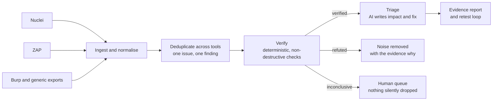

# Aegis: the verification layer for security findings

[](https://github.com/RahilSahu/aegis-security-platform/actions/workflows/tests.yml)

**Scanners find. Aegis proves.**

## The problem nobody talks about

The security industry solved *finding* vulnerabilities years ago. Nuclei, ZAP, Burp and a dozen AI scanners will happily produce thousands of findings. What nobody solved is the part that eats security teams alive:

- Industry analyses of scanner output routinely find that a large share of findings are false positives, duplicates, or not exploitable in context, yet every one lands on a human's desk as if it were proven.
- The same issue reported by two tools becomes two tickets. Three tools, three tickets.
- Anthropic's own OSS Scanner disclosed the shape of the problem at industry scale in 2026: over 29,000 candidate vulnerabilities generated, only about 6,000 human-reviewed, because **validation, not detection, is the bottleneck**. Their reports ship unverified by design.
- Meanwhile the AI-pentest wave (Burp MCP giving a model hands inside Burp, autonomous frameworks like HexStrike chaining real exploits) optimises the *attack* side. It makes the noise problem worse, and it makes claims no one can audit: an agent's confidence is not evidence.

So the industry drowns in unverified claims, and the scarcest resource in security, expert validation time, is spent re-checking scanner output by hand.

## The solution

Aegis sits *after* every scanner and *before* every ticket:



Four design decisions make Aegis different:

1. **Verification is deterministic, never AI.** Statuses (verified, refuted, inconclusive) come only from safe, reproducible checks: a GET request, a header read, a certificate inspection, a token decode. No payloads, no exploitation. If a check cannot decide, the finding is inconclusive, in writing.
2. **AI advises, evidence decides.** With an API key (OpenAI, Anthropic or Google), the model writes the analyst layer: exploitability reasoning, business impact in plain language, developer-ready remediation, priority. It is architecturally incapable of changing a verification status; that rule is enforced by the code layout and covered by a test. Without a key, a transparent heuristic engine produces the same shape, so the platform works fully offline.
3. **Cross-tool corroboration is signal.** One fingerprint per issue, regardless of which scanner named it. When Nuclei and ZAP independently report the same CORS flaw, Aegis merges them and the risk score rises: two tools agreeing is evidence.
4. **Retest is built in.** Fix the issue, re-run verification, and the finding flips to refuted with fresh evidence. Aegis closes the loop that pentesters currently close by hand, retesting the same fixes sprint after sprint.

### How it differs

| | Scanners (Nuclei, ZAP) | Burp MCP / agent frameworks | Aegis |
| --- | --- | --- | --- |
| Job | Find candidate issues | Give an AI hands to attack | Prove or kill every claim |
| Output | Raw findings, duplicates included | Agent actions and notes | One finding per issue, with evidence |
| Who decides truth | Nobody, it is your problem | The model, unaccountably | Deterministic checks only |
| False positives | Your backlog | More findings, faster | Refuted, with the reason recorded |
| Safety | Safe | Runs real exploits | Non-destructive checks by design |

Honest prior art: enterprise platforms (Pentera, XM Cyber) validate exploitability commercially with attack simulation, and offensive engines have begun adding validation stages. Aegis's contribution is the open, tool-agnostic verification layer for the scanner output teams already have, with the AI explicitly fenced out of the verdict.

## Quick start

```bash
pip install -r requirements.txt   # only the web service needs dependencies

# 1. Ingest what your scanners already produced
python -m aegis.cli ingest scan-nuclei.jsonl scan-zap.json --db aegis.json
# ingested: 4 new, 2 merged as duplicates, 4 total

# 2. Verify against the live target (authorised systems only)
python -m aegis.cli verify --db aegis.json
# verification: {'verified': 4, 'refuted': 0, 'inconclusive': 0, 'skipped': 0}

# 3. Triage (uses your AI API key when set, heuristic engine otherwise)
python -m aegis.cli triage --db aegis.json

# 4. Report
python -m aegis.cli report --db aegis.json --out report.md

# Or the web dashboard
uvicorn api:app --port 8200
```

Reports come in three production formats: Markdown for tickets, standalone print-ready HTML for clients and management (executive metrics, per-finding evidence, OWASP mapping, fix effort and SLA), and JSON for pipelines. Sample scanner exports are in `samples/`, pointed at a local test target, so the whole pipeline can be tried end to end.

## Verified classes in v1

security headers, CORS reflection, cookie flags, TLS certificate validity, JWT signing flaws (alg none, unsigned, expired), version disclosure, exposed sensitive files (a publicly readable `.env` or `.git/HEAD`, judged on content markers, not bare status codes), and directory listing. Findings of other classes are ingested, deduplicated, scored and triaged, and marked inconclusive rather than guessed at. Adding a verifier is one function in `aegis/verify.py`. Verification runs concurrently, so a 500-finding backlog verifies in seconds, and `aegis diff before.json after.json` produces the retest view: fixed, still open, regressed, new.

## Architecture

- `aegis/models.py`: unified Finding schema, cross-tool fingerprinting, evidence-based risk scoring (severity x verification status x corroboration).
- `aegis/ingest.py`: parsers for Nuclei JSONL, ZAP JSON, Burp Suite XML (including base64-encoded fields), generic JSON and CSV, content-based format detection, tolerant of corrupt lines in large exports.
- `aegis/verify.py`: the verifier registry. The only module allowed to set a status.
- `aegis/ai.py`: provider-agnostic triage (OpenAI, Anthropic, Google) with a heuristic fallback engine.
- `aegis/store.py`: deduplicating store with JSON persistence.
- `aegis/report.py` and `aegis/cli.py`: the evidence report and command line.
- `api.py`: FastAPI service and dashboard.

## Tests

60 tests, run like a QA suite, not a smoke test: parser and merge behaviour on the bundled cross-tool samples, Burp XML with base64 fields, malformed-line tolerance, scoring rules, JWT verification, TLS verification against a locally generated self-signed certificate, AI triage shape and the status invariant, the full API flow, hostile-input handling (garbage uploads return 422, finding titles are HTML-escaped in the dashboard), concurrent duplicate ingestion, a 1,000-finding load check, bulk concurrent verification, retest diffing, the CLI end to end, and **live verification against a deliberately vulnerable local target and its patched twin** (the vulnerable one verifies everything, the patched one refutes everything). Round two added fingerprint-identity tests (ports separate apps, trailing slashes and numeric IDs merge), a fuzz dedupe over 300 randomised scanner variants, SSRF-guard tests, report determinism and metrics checks, LLM-failure fallback, double-ingest idempotency, and atomic-save round-trips. Round three added verifier precision (partial header sets, HSTS scoped to HTTPS, per-cookie flag attribution, CORS variants), timeout behaviour against a slow target, real-world export quirks (ZAP's cweid -1, missing Nuclei fields, Burp's Information severity), unicode integrity, and a full black-box CLI pipeline test against a live target. The dashboard and the HTML report are additionally screenshot-tested at desktop and phone widths.

```bash
python -m pytest tests -q   # or: python -m unittest discover -s tests
```

## Responsible use

Verifiers make only read-only checks, and Aegis has no exploitation capability by design. Because Aegis fetches URLs taken from scanner files, it also defends itself: an SSRF guard refuses to fetch cloud metadata and link-local targets (a crafted scanner export is an attack vector), overridable only by an explicit operator opt-in. Still: run verification only against systems you own or have explicit authorisation to test. This is a professional tool for security teams, not a scanner for other people's infrastructure.

## Roadmap

- Nessus and Nessus-style parsers (Burp Suite XML landed in v1.1.0)
- Authenticated verification (session-aware checks for IDOR-class findings with test accounts)
- Scheduled retest jobs that run the diff automatically each sprint
- Ticket export (Jira, GitHub Issues) with the evidence attached
- A verifier plugin API so teams can add organisation-specific checks

## License

MIT, see LICENSE.
